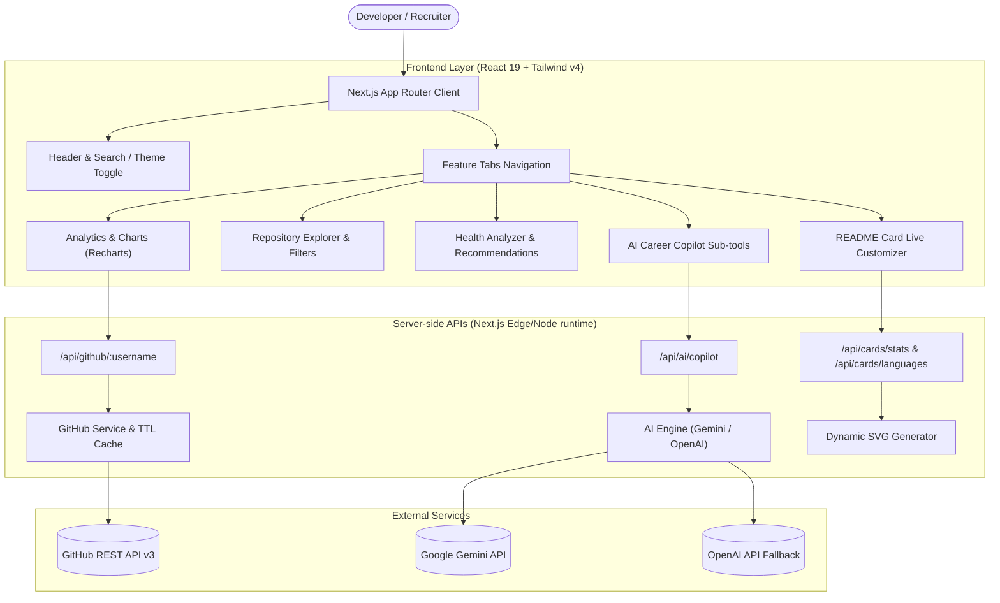

# ⚡ DevPulse AI

> **Professional GitHub Analytics & AI Career Assistant for Developers**  
> Transform public GitHub activity into verifiable career assets, actionable repository health audits, and embeddable README cards.

[](https://github.com)
[](https://nextjs.org)
[](https://www.typescriptlang.org)
[](https://tailwindcss.com)
[](https://vitest.dev)
[](LICENSE)

---

## 🌟 Overview

**DevPulse AI** is a full-stack, production-ready developer platform designed for software engineers, engineering managers, and technical recruiters. It bridges raw GitHub development data with actionable career intelligence:

1. **GitHub Analytics Dashboard**: Live metrics for stars, forks, languages, and 14-day commit velocity with interactive Recharts visualizations.
2. **AI Career Copilot**: Generates grounded, evidence-based CV bullet points, architecture summaries, and weekly standup reports without hallucinating nonexistent features.
3. **Project Health Analyzer**: Audits repository hygiene (missing descriptions, missing licenses, lack of topics, dormant repos) and prescribes prioritized fixes.
4. **README Card Generator**: Dynamic SVG cards for GitHub statistics and language distributions that developers can embed directly into their GitHub profile READMEs.
5. **Zero-Friction Offline/Demo Mode**: Built-in curated profiles (`shadcn`, `torvalds`, `leerob`, `octocat`) ensuring uninterrupted evaluation even when GitHub's unauthenticated API rate limits are hit.

---

## 🏗 Architecture



---

## 🚀 Key Features

### 1. GitHub Analytics Dashboard
- Instant lookup by any public GitHub username with Zod-validated input regex.
- Aggregated metrics across all public repositories: Total Stars, Total Forks, Primary Stack, 30-Day Commits, and Public Repository Count.
- **Language Distribution Chart**: Interactive Recharts Donut chart with percentage breakdown and GitHub color accents.
- **14-Day Activity Pulse**: Gradient-filled AreaChart tracking daily commits, pull requests, and issues.
- **Repository Explorer**: Filter by primary language, sort by stars/forks/recency, and toggle upstream forks.

### 2. AI Career Copilot
- **Evidence-Based CV Bullet Points**: Generates quantifiable resume bullets tailored to target engineering roles (e.g., Senior Full-Stack, Frontend Specialist) with demonstrated skills tags.
- **Architecture Summarizer**: Distills complex codebases into 2-sentence executive summaries, architecture highlights, and primary stacks for portfolios.
- **README Optimizer**: Identifies missing sections, suggests quick wins, and provides copy-paste markdown installation templates.
- **Weekly Development Report**: Synthesizes recent commit events into accomplishments and focus areas for standups or 1-on-1s.
- **Strict Anti-Hallucination Policy**: Grounded exclusively in supplied GitHub data; clearly distinguishes missing fields from zero values.

### 3. Project Health Analyzer
- Calculates an evidence-based **Health Index (0–100)** and category (`Good`, `Needs Attention`, `At Risk`).
- Flags repositories with missing descriptions, absent open-source licenses, missing topics, or dormant push history (> 180 days).
- Provides actionable, numbered recommendations rather than opaque arbitrary scores.

### 4. Dynamic SVG README Cards
- Live SVG endpoints:
  - `/api/cards/stats?username=<user>&theme=<dark|light|cyberpunk|radical>`
  - `/api/cards/languages?username=<user>&theme=<dark|light|cyberpunk|radical>`
- Vector sharp on high-DPI displays with accessible `<title>` and `<desc>` attributes.
- Copyable Markdown and HTML snippets for one-click pasting into GitHub profile READMEs.

---

## 🛠 Technology Stack

- **Framework**: [Next.js](https://nextjs.org/) 16 App Router (Turbopack / Webpack hybrid)
- **UI & Styling**: [React](https://react.dev/) 19, [Tailwind CSS](https://tailwindcss.com/) v4, [Lucide React](https://lucide.dev/)
- **Data Visualization**: [Recharts](https://recharts.org/) (Responsive Donut & Area Charts)
- **Validation**: [Zod](https://zod.dev/) for GitHub API responses and structured AI JSON outputs
- **AI Models**: Google Gemini 2.5 Flash API (with OpenAI fallback & deterministic evidence engine)
- **Unit Testing**: [Vitest](https://vitest.dev/) with JSDOM
- **E2E Testing**: [Playwright](https://playwright.dev/)
- **CI/CD**: GitHub Actions workflow (`.github/workflows/ci.yml`)

---

## 💻 Getting Started

### Prerequisites
- Node.js 20 or higher (`node -v`)
- npm or pnpm

### Installation

1. **Clone the repository**:
   ```bash
   git clone https://github.com/your-username/devpulse-ai.git
   cd devpulse-ai
   ```

2. **Install dependencies**:
   ```bash
   npm install
   ```

3. **Configure Environment Variables**:
   Copy `.env.example` to `.env.local`:
   ```bash
   cp .env.example .env.local
   ```

   Fill in your configuration:
   ```env
   # Optional: GitHub PAT for 5,000 requests/hr (avoids 60/hr public IP limit)
   GITHUB_TOKEN=your_github_token_here

   # AI Copilot: Google Gemini API Key
   GEMINI_API_KEY=your_gemini_api_key_here

   # Optional fallback: OpenAI API Key
   OPENAI_API_KEY=your_openai_api_key_here
   ```
   *(Note: DevPulse AI operates seamlessly out of the box using built-in demo profiles and its deterministic evidence engine even if no API keys are provided!)*

4. **Start the development server**:
   ```bash
   npm run dev
   ```
   Open [http://localhost:3000](http://localhost:3000) in your browser.

---

## 🧪 Testing

### Running Unit Tests (Vitest)
Unit tests cover GitHub data transformations, rate-limit header parsing, project health scoring, and Zod schemas:
```bash
npm test
```

### Running Tests in Watch Mode
```bash
npm run test:watch
```

### Running End-to-End Tests (Playwright)
```bash
npx playwright test
```

---

## 📦 Deployment to Vercel

DevPulse AI is architected specifically for zero-configuration deployment to Vercel:

1. Push your repository to GitHub.
2. Import the project into [Vercel](https://vercel.com/new).
3. Under **Environment Variables**, add:
   - `GITHUB_TOKEN` *(optional but recommended for production)*
   - `GEMINI_API_KEY`
4. Click **Deploy**. Vercel will automatically build the Next.js App Router project and serve dynamic SVG cards and API routes via serverless edge functions.

---

## 🔒 Security & Best Practices

- **Zero Client-Side Secrets**: All API tokens (`GITHUB_TOKEN`, `GEMINI_API_KEY`, `OPENAI_API_KEY`) are accessed strictly within Next.js Route Handlers server-side.
- **Server-Side In-Memory Caching**: GitHub responses are cached with a 10-minute TTL to respect rate limits and minimize redundant network hops.
- **Graceful Degradation**: Clear rate-limit headers (`x-ratelimit-remaining`, `x-ratelimit-reset`) are surfaced in the UI with instant fallback to high-fidelity demo profiles.
- **Zod Schema Hardening**: All inputs (usernames) and outputs (GitHub API JSON, LLM JSON) are parsed through strict schemas before rendering.

---

## 📄 License

This project is licensed under the [MIT License](LICENSE).
